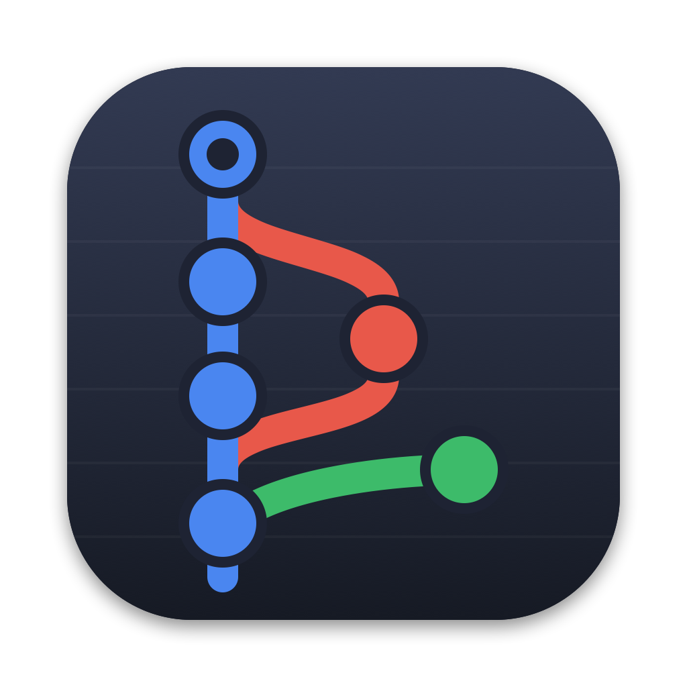
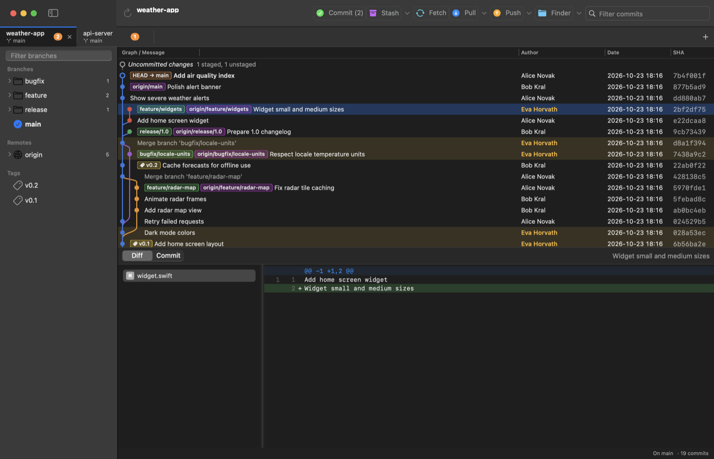

<p align="center">
  
</p>

<h1 align="center">Grafit</h1>

<p align="center">A fast, native Git client for macOS with a clear revision graph.</p>



Grafit is a SwiftUI app that drives the regular `git` command line, so it works with your existing
config, SSH keys and credential helpers. Its workflow is inspired by
[Git Extensions](https://gitextensions.github.io) on Windows.

> Grafit is an independent project. It is not affiliated with or endorsed by Git Extensions.

## Features

**History**
- Revision graph with colored lanes, branch, remote and tag badges, and an "Uncommitted changes" row
- Click a commit to highlight every commit by the same author (⇧⌘A to toggle)
- Filter commits by message, author, SHA or ref, and move through the list with the keyboard
- Resizable Author, Date and SHA columns plus an adjustable maximum graph width
- Bottom pane with changed files and diff (choose the parent for merges) and a commit info tab

**Working with repositories**
- Tabs, one per repository. Each tab shows the current branch, the number of changed files and any merge or rebase in progress. Open tabs are restored on launch.
- Sidebar with branches, remotes and tags grouped into folders (`feature/`, `bugfix/`, `release/`, `4.1.x`, …), a filter box, and stashes
- Clone (⇧⌘O) and create (⇧⌘N) repositories without leaving the app

**Committing**
- Commit dialog (⌘K): stage, unstage or discard whole files or selected lines and hunks; amend; push after commit
- Shows the identity you are committing as

**Branches and history rewriting**
- Commit context menu: checkout, new branch or tag, merge, rebase, cherry-pick, revert, reset (soft, mixed or hard), delete branch or tag, copy SHA
- Interactive rebase from any commit on the current branch: pick, reword, edit, squash, fixup or drop, and drag to reorder
- Edit the message of the last commit or of an older one
- Warns when the commits you rewrite are already pushed

**Stash and conflicts**
- Stash with a message, optionally including untracked files; view, pop, apply and drop stashes from the sidebar
- Conflict resolver: use ours or theirs, open your merge tool or editor, mark as resolved, then continue or abort

**Remotes and settings**
- Fetch (⇧⌘F), pull with merge or rebase (⇧⌘L), push or force push with lease (⇧⌘P)
- Color-coded toolbar, and a Finder button that opens the repository folder in Finder or Terminal (⇧⌘R)
- Settings (⌘,): global and per-repository name and email, commits to load, clone folder, merge tool, and pull and fetch defaults
- Dark mode by default (⇧⌘D)

## Requirements

- macOS 14 Sonoma or later
- Xcode command line tools (provides `git` and `swift`)

## Build and install

```bash
git clone https://github.com/<you>/grafit.git
cd grafit
scripts/bundle.sh --install
```

This builds a release binary, wraps it in `build/Grafit.app` and copies it to `/Applications`.
The app is ad-hoc signed. If macOS refuses to open it, right-click it in Finder and choose **Open**.

Open a repository from the app (⌘O), from the terminal, or by dropping a folder on the Dock icon:

```bash
open -a Grafit ~/code/my-project
```

## Keyboard shortcuts

| Action | Shortcut |
| --- | --- |
| Open repository in a new tab | ⌘T or ⌘O |
| Close tab | ⌘W |
| Next or previous tab | ⌃Tab or ⌃⇧Tab |
| Go to tab 1–9 | ⌘1 … ⌘9 |
| Clone or new repository | ⇧⌘O or ⇧⌘N |
| Refresh | ⌘R |
| Commit | ⌘K, then ⌘↩ to commit |
| Fetch, pull or push | ⇧⌘F, ⇧⌘L or ⇧⌘P |
| Open repository in Finder | ⇧⌘R |
| Highlight same author | ⇧⌘A |
| Dark mode | ⇧⌘D |
| Settings | ⌘, |

## Development

```bash
swift build                    # debug build
swift test                     # staging, rebase, stash, conflicts, clone and graph tests
swift scripts/make-icon.swift  # re-render Resources/AppIcon.icns
```

| Path | Contents |
| --- | --- |
| `Sources/Grafit/Git` | git process runner, command wrappers, diff parsing and partial patches |
| `Sources/Grafit/Graph` | lane layout and drawing of the revision graph |
| `Sources/Grafit/Views` | SwiftUI windows and dialogs |
| `Sources/Grafit/App` | app entry point, tabs and per-repository state |

Two environment variables help with screenshots:

- `GRAFIT_SNAPSHOT=/tmp/shot` saves PNGs of all windows four seconds after launch.
- `GRAFIT_DEBUG_ACTION` opens a dialog on launch. It accepts `commit`, `stash`, `conflicts`, `rebase`, `reword`, `clone`, `settings` or `select:<row>`.

## License

Grafit is released under the [MIT License](LICENSE).
